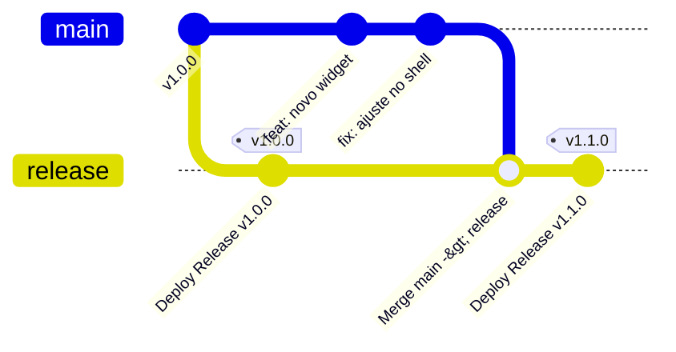

# `fzl-fund-appshell--lit`

> Shell de aplicação PWA desenvolvido em Lit 3.x, parte integrante do ecossistema de fundos `fzlbpms-funds` no monorepo `fzl-fund-ui`.

O **AppShell** atua como a casca anfitriã e integradora para os Web Components do monorepo (`@fzl/webcomponents-lit`, `@fzl/design-tokens`, etc.). Ele provê roteamento client-side via hash (`#/`), gerenciamento de estado reativo, autenticação social (Google OAuth2 e Microsoft Entra ID), notificações Web Push, internacionalização (i18n), leitor de acessibilidade (TTS) e PWA offline.

---

## 🚀 Comandos Principais (a partir da raiz do monorepo)

| Comando | Descrição |
| :--- | :--- |
| `npm run dev:appshell` | Inicia o servidor Vite de desenvolvimento do AppShell |
| `npm run build:appshell` | Compila o `@fzl/webcomponents-lit` e gera o bundle de produção em `appshell-lit/dist/` |
| `npm test --workspace=fzl-fund-appshell--lit` | Executa a suíte completa de testes unitários (Vitest) |

---

## 🌿 Estratégia de Branches & Gestão de Releases

Para garantir alta disponibilidade e evitar que alterações em desenvolvimento desestabilizem a aplicação no ar, adotamos a convenção de branches:



* **`main`**: Branch de desenvolvimento contínuo. Commits e PRs são integrados aqui. A cada push, o GitHub Actions executa os testes e publica uma versão de preview no ar.
* **`release`**: Branch estável que representa rigorosamente o estado homologado em produção.

### Como Lançar uma Nova Release

Quando a `main` estiver validada e pronta para corte de versão:

```bash
# 1. Mude para a branch de release e faça o fast-forward da main
git checkout release
git merge main --ff-only

# 2. Crie a tag semântica imutável
git tag v1.1.0

# 3. Envie a branch e as tags para o GitHub (dispara deploy da release)
git push origin release --tags
```

---

## 🛡️ Plano de Contingência: Redeploy de Emergência (Rollback em 1 Clique)

Se um deploy recente disparado pela branch `main` introduzir algum erro de runtime ou quebrar a aplicação no ar, você **não precisa** correr para criar commits de `git revert` sob pressão.

A pipeline [`.github/workflows/deploy-appshell.yml`](../.github/workflows/deploy-appshell.yml) possui um seletor parametrizado de rollback que recompila e restaura a versão estável da `release` em menos de 1 minuto:

### Como Acionar o Rollback

#### Opção A — Pela Interface Web do GitHub (Recomendado)
1. Acesse o repositório no GitHub e vá até a aba **Actions**.
2. No menu lateral esquerdo, selecione o workflow **Deploy appshell (GitHub Pages)**.
3. No canto superior direito, clique em **Run workflow**.
4. No campo **Branch ou tag para deploy/rollback no GitHub Pages**, selecione: **`release`**.
5. Clique no botão verde **Run workflow**.

#### Opção B — Pelo Terminal com GitHub CLI (`gh`)
```bash
gh workflow run deploy-appshell.yml -f target_ref=release
```

---

## 📚 Documentação Complementar

* [Guia Completo de Deploy, CI/CD e Ambientes](./documentation/deploy.md)
* [Especificação Arquitetural do AppShell](./documentation/specification.md)
* [ADR 003: Integração do AppShell no Monorepo](../docs/architecture/003-appshell-in-monorepo.md)
* [Guia de Integração de Web Components em Aplicações Hospedeiras](../docs/guides/host-integration.md)
