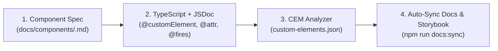

# FZL Web Components — Documentation Hub

Welcome to the documentation hub for `fzl-fund-ui-widgets-components`. This directory is structured using a **Docs-as-Code** workflow so that our documentation stays strictly synchronized with the implementation across all three Web Component approaches (`webcomponents-es6`, `webcomponents-lit`, and `webcomponents-angular`).

---

## How We Keep Documentation Synchronized

Every widget follows a 4-step lifecycle:

1. **Specification First (`docs/components/<name>.md`):** Before coding a new widget, copy [`_template.md`](./components/_template.md) to define the UX purpose, functional requirements, and target attributes/events across ES6, Lit, and Angular.
2. **Code with Rich JSDoc Annotations:** Document attributes, properties, custom events, slots, CSS variables, and Shadow DOM parts directly in the TypeScript component class.
3. **Custom Elements Manifest (`npm run analyze`):** Generates standards-compliant `custom-elements.json` files inside each package.
4. **Automated Markdown Sync (`npm run docs:sync`):** Injects the generated API tables between `<!-- CEM:START -->` and `<!-- CEM:END -->` markers in `docs/components/<name>.md`.

---

## Contents

### Architecture Decision Records (`docs/architecture/`)
- [ADR-001: Monorepo Workspace & Multi-Engine Web Components](./architecture/001-monorepo-and-tech-stack.md)
- [ADR-002: Design Tokens, Shadow DOM Encapsulation & Form Participation](./architecture/002-design-tokens-and-shadow-dom.md)

### Integration Guides (`docs/guides/`)
- [Consuming `<fzl-*>` Widgets in Host Applications (Angular, React, Vue, Plain HTML)](./guides/host-integration.md)

### Component Specifications (`docs/components/`)
- [Component Specification Template (`_template.md`)](./components/_template.md)
