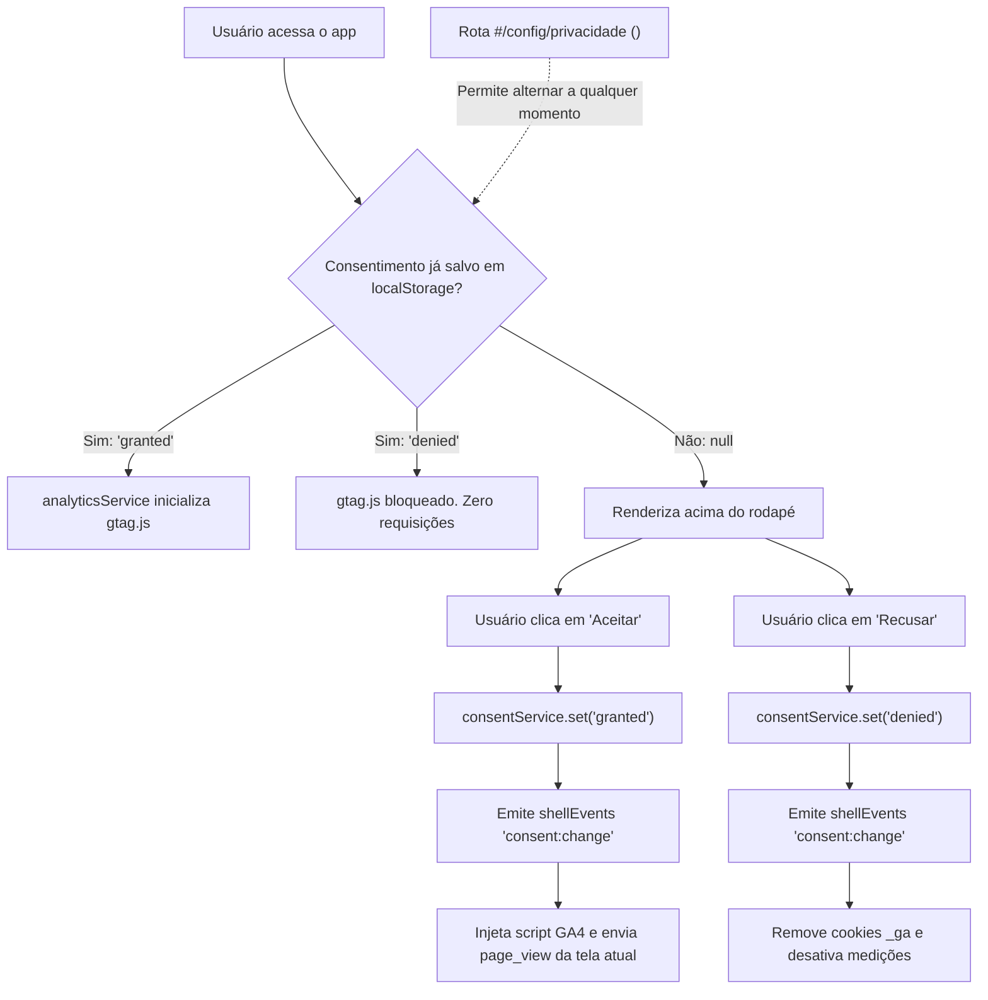

# Component Specification: Consent Banner (`consent-banner`)

> **Status:** Production Ready  
> **Category:** Privacy, Security & Regulatory Compliance (LGPD / GDPR / ePrivacy)  
> **Implementations:**
> - Lit: `<consent-banner>` (`fzl-fund-appshell--lit`)
> **Related Views & Services:**
> - Service: `consentService` (`src/services/consent-service.js`)
> - Analytics: `analyticsService` (`src/services/analytics-service.js`)
> - Privacy View: `<config-privacy-view>` (`src/webcomponents/config-privacy-view.js`)
> - Architecture Guide: `docs/architecture/007-consent-management-platforms-and-cookiebot.md`

---

## 1. Overview & Purpose

The `consent-banner` component provides a lightweight, non-intrusive, and accessible user consent interface designed for telemetry and analytics compliance under the Brazilian **LGPD (Lei Geral de Proteção de Dados - Lei 13.709/2018)** and European **GDPR (General Data Protection Regulation)**.

Unlike aggressive commercial pop-ups, `<consent-banner>` is rendered **in-flow** directly above the application footer (`<app-footer>`). It does not obstruct content or trap keyboard focus with dark overlays, ensuring that accessibility (WCAG 2.1/2.2 AAA) is fully maintained.

### Core Principles
1. **Zero Dark Patterns:** "Recusar" (Decline) and "Aceitar" (Accept) buttons have identical visual weight (`md-outlined-button`), strictly satisfying the requirement that revoking or denying consent must be as effortless as conceding it (LGPD Art. 8º §5º).
2. **Basic Consent Mode by Default:** If the user has not yet consented or explicitly declines, Google Analytics 4 scripts (`gtag.js`) are **never downloaded from the network**. Zero telemetry packets or cookies leave the client.
3. **Persistence & Isolation:** The decision is stored under `localStorage` namespaced with the application prefix (`<prefix>:consent:analytics`), allowing multiple applications hosted on the same origin (e.g., GitHub Pages subpaths) to operate independently.
4. **Instant Revocation:** Users can review and toggle their consent at any time via route `#/config/privacidade`. Revoking immediately turns off GA4 and sweeps all `_ga*` cookies from the browser.

---

## 2. Usage Examples

### Standard HTML
```html
<consent-banner privacyUrl="#/config/privacidade"></consent-banner>
```

### Lit Component Template
```javascript
import { html } from 'lit'
import '../webcomponents/consent-banner.js'

render() {
  return html`
    <consent-banner
      .privacyUrl=${'#/config/privacidade'}
    ></consent-banner>
  `
}
```

### Configuration via `appshell.config.js`
```javascript
export default defineAppShellConfig({
  title: 'Meu Aplicativo',
  analytics: {
    provider: 'ga4',
    id: 'G-XXXXXXXXXX',
    requireConsent: true,           // Exibe o banner para novos usuários
    privacyUrl: '#/config/privacidade', // Link para a política de privacidade
    cmp: 'internal',                // 'internal' (nativo Lit) | 'cookiebot' | 'custom' | 'none'
    consentMode: 'basic',           // 'basic' (bloqueio total) | 'advanced' (cookieless pings)
  },
})
```

---

## 3. Architecture & Data Flow



---

## 4. Google Consent Mode v2: Basic vs. Advanced

Under Google's framework (described in Google Support Answer 14546767), two operational modes are supported:

| Característica | Nosso Padrão: Modo Básico (*Basic*) | Modo Avançado (*Advanced*) |
| :--- | :--- | :--- |
| **Download do script `gtag.js`** | **Apenas após consentimento explícito.** | Carregado imediatamente na inicialização da página. |
| **Estado inicial dos sinais** | Bloqueado na camada de transporte (sem rede). | Inicializado com sinais `denied` via `gtag('consent', 'default', ...)`. |
| **Pings sem cookie (*Cookieless Pings*)** | **Nenhum.** Zero tráfego de rede para o Google. | Envia pings anônimos de telemetria sem ler/gravar cookies. |
| **Modelagem por IA no GA4** | Sem modelagem para usuários que recusaram. | O Google usa machine learning para estimar conversões e tráfego recusado. |
| **Conformidade Ética / LGPD** | **Máxima.** Nenhuma transmissão de dados sem base legal prévia. | Aceito sob GDPR com base em legítimo interesse/pings anônimos, mas controverso sob certas DPOs. |
| **Resiliência Offline / PWA** | **100% autônomo.** Não atrasa o carregamento inicial da aplicação. | Faz chamadas HTTP externas no primeiro carregamento. |

### Os 7 Sinais do Google Consent Mode v2
O `appshell-lit` mapeia os sinais padrão da seguinte forma:
1. `analytics_storage`: `'granted'` ou `'denied'` (acompanha a escolha do usuário).
2. `ad_storage`: `'denied'` (o appshell não veicula anúncios comerciais).
3. `ad_user_data`: `'denied'` (sem compartilhamento de dados com redes de publicidade).
4. `ad_personalization`: `'denied'` (sem personalização de anúncios ou remarketing).
5. `functionality_storage`: `'granted'` (necessário para persistência de sessão e PWA).
6. `personalization_storage`: `'denied'` ou controlado por preferências locais.
7. `security_storage`: `'granted'` (armazenamento estritamente necessário para segurança).

---

## 5. Comparativo: Banner Nativo Lit vs. Cookiebot vs. Alternativas Livres

O Cookiebot é uma plataforma de gerenciamento de consentimento (CMP) comercial líder de mercado. Abaixo está a comparação detalhada com o nosso componente nativo e as principais alternativas livres do ecossistema:

| Critério | Nativo Lit (`<consent-banner>`) | Cookiebot CMP (SaaS) | Vanilla-CookieConsent (Orest Bida) | Klaro! (Open Source) |
| :--- | :--- | :--- | :--- | :--- |
| **Licença / Custo** | **Software Livre (GPLv3 / Monorepo)** | Proprietário pago (mensalidade em Euros por domínio) | MIT (Livre / Gratuito) | BSD-3-Clause (Livre / Gratuito) |
| **Tamanho & Dependências** | **Zero dependências extras (Lit nativo)** | ~80 KB script remoto de CDN externa | ~15 KB gzip (Vanilla JS) | ~35 KB (Vanilla JS) |
| **PWA / Suporte Offline** | **Totalmente offline-ready** | Quebra ou falha sem conexão de rede | Suporta empacotamento offline | Suporta empacotamento offline |
| **Certificação Google CMP** | Custom CMP (não lista oficial) | **Sim (Certificado Google & IAB TCF v2.2)** | Custom CMP | Custom CMP |
| **Scanner Automático de Cookies** | Manual (via tabela declarativa) | **Automático (crawler periódico em nuvem)** | Manual (declarativo em JSON) | Manual (declarativo em JSON) |
| **Design System** | **Material 3 idêntico ao App Shell** | Modal externo sobreposto (requer CSS custom) | Temas personalizáveis | Temas personalizáveis |
| **Risco de Adblockers** | **Inimputável (código interno do app)** | Frequentemente bloqueado por Brave / uBlock | Raramente bloqueado se self-hosted | Raramente bloqueado se self-hosted |
| **Granularidade** | Simples (analítico) ou por categorias | Granular (Necessários, Estatísticas, Marketing) | Granular (alta flexibilidade) | Granular (por serviço e finalidade) |
| **Prova de Consentimento** | Local (`localStorage` auditável no device) | Nuvem com hash de IP e carimbo de tempo | Local ou via callback para API própria | Local ou via callback para API própria |

---

## 6. Quando Utilizar Cada Abordagem?

### Cenário A: Utilizar o Banner Nativo Lit (Recomendado para a maioria dos casos)
* Aplicações corporativas internas, portais governamentais, sistemas de gestão de fundos e investimentos (*fintechs*).
* Foco estrito em **LGPD brasileira**, onde não há veiculação de anúncios Google Ads e o objetivo é telemetria transparente.
* Aplicações que priorizam velocidade extrema, zero custos recorrentes de terceiros e funcionamento PWA offline.

### Cenário B: Integrar com Cookiebot
* Aplicações comerciais globais com tráfego relevante no **Espaço Econômico Europeu (EEE) e Reino Unido**.
* Sites com monetização via **Google AdSense, AdMob ou campanhas avançadas de remarketing no Google Ads**.
* Organizações cujo departamento jurídico/DPO exige um **relatório automatizado de auditoria mensal** com crawler de cookies em nuvem.

### Cenário C: Integrar com Alternativa Open Source (ex.: Vanilla-CookieConsent / Klaro!)
* Projetos que desejam consentimento granular multicategoria (ex.: separar cookies de mapas Leaflet, vídeos e analytics), mas **sem pagar taxas mensais de SaaS** e mantendo todo o código dentro do repositório.

---

## 7. Como Integrar o Cookiebot no Projeto

Para projetos que optarem por usar o Cookiebot, o App Shell oferece integração declarativa:

```javascript
// appshell.config.js
export default defineAppShellConfig({
  analytics: {
    provider: 'ga4',
    id: 'G-XXXXXXXXXX',
    cmp: 'cookiebot',
    cookiebotId: '00000000-0000-0000-0000-000000000000',
    consentMode: 'advanced', // ou 'basic'
  },
})
```

Quando configurado com `cmp: 'cookiebot'`:
1. O App Shell suprime o `<consent-banner>` interno.
2. Injeta o script oficial do Cookiebot:
   ```html
   <script id="Cookiebot" src="https://consent.cookiebot.com/uc.js" data-cbid="00000000-0000-0000-0000-000000000000" type="text/javascript"></script>
   ```
3. Escuta os eventos `CookiebotOnConsentReady` e `CookiebotOnDecline`, sincronizando automaticamente com o `consentService` do shell e o barramento `shellEvents`.
4. Na tela `#/config/privacidade`, exibe o botão **"Gerenciar preferências de cookies no Cookiebot"**, invocando `Cookiebot.renew()`.

---

## 8. Acessibilidade (WCAG 2.1 / 2.2 AAA)

* **Sem armadilhas de teclado (*Keyboard Trap*):** O banner fica no fluxo do documento, permitindo navegação fluida via Tab.
* **Sem salto de foco (*Focus Shift*):** O leitor de tela lê o conteúdo sem roubar o foco arbitrariamente do `<main>`.
* **Identificação Semântica:** A área de consentimento utiliza `role="region"` com `aria-label="Consentimento de cookies"`.
* **Contraste Mínimo:** Todos os textos e contornos respeitam contraste mínimo de 7:1 (AAA) em tema claro e escuro.
