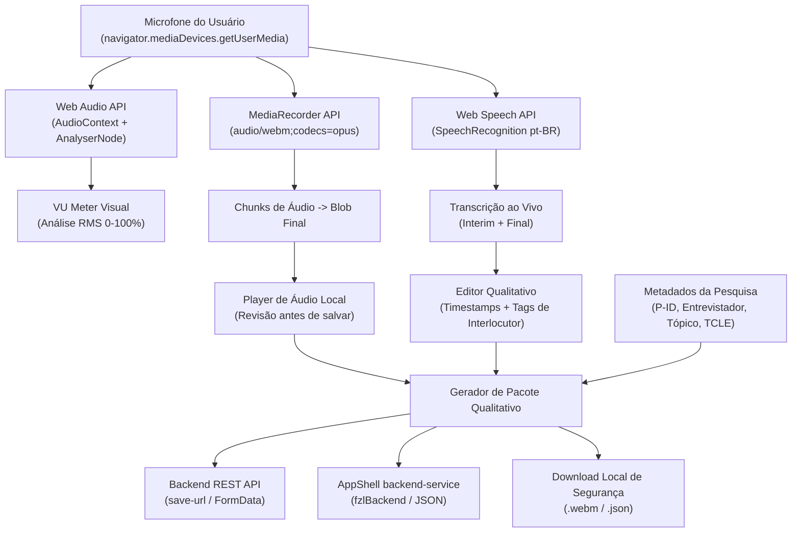

# Arquitetura do Componente de Gravação & Transcrição para Pesquisa Qualitativa

Especificação arquitetural e guia de integração do componente `<fzl-lit-interview-transcriber>` no monorepo e AppShell.

---

## 🏛️ Visão Geral da Arquitetura

O componente adota o padrão de arquitetura modular, reativa e desacoplada dos componentes avançados do Fzl Fund UI (como o `fzl-lit-avatar-upload` e o `fzl-lit-geo-explorer`).



---

## 🔒 Princípios de Ética e Privacidade na Pesquisa Qualitativa

1. **Anonimização por Padrão**:
   - Os campos de identificação utilizam pseudônimos ou códigos do protocolo de pesquisa (ex: `P-01`, `Participante B`), protegendo os dados sensíveis do informante conforme a LGPD e as normas de comitês de ética em pesquisa (CEP/CONEP).
2. **Confirmação Explícita de Consentimento (TCLE)**:
   - O botão de salvar permanece desabilitado até que a confirmação do Termo de Consentimento Livre e Esclarecido esteja marcada.
3. **Resiliência Offline e Salva-guarda de Dados de Campo**:
   - Entrevistas de campo frequentemente ocorrem em ambientes com conectividade instável. O componente permite o download local imediato do arquivo de áudio (`.webm`) e do arquivo estruturado de metadados + notas (`.json`), garantindo que o pesquisador nunca perca os dados coletados.

---

## 🔌 Compatibilidade entre Navegadores e Modos de Transcrição

| Navegador | Captura de Áudio (`MediaRecorder`) | VU Meter (`Web Audio`) | Transcrição Nativa (`Web Speech API`) | Fallback Suportado |
| :--- | :--- | :--- | :--- | :--- |
| **Google Chrome / Chromium** | ✅ Total | ✅ Total | ✅ Total (pt-BR, en-US, etc.) | N/A |
| **Microsoft Edge** | ✅ Total | ✅ Total | ✅ Total | N/A |
| **Apple Safari (macOS / iOS)** | ✅ Total (`audio/mp4` ou `webm`) | ✅ Total | ✅ Total (`webkitSpeechRecognition`) | N/A |
| **Mozilla Firefox** | ✅ Total (`audio/webm` ou `ogg`) | ✅ Total | ⚠️ Parcial / Indisponível nativamente | ✅ Gravação do áudio preservada + alerta visual instruindo transcrição via backend (Whisper) |

---

## 🚀 Integração com o Backend

### Exemplo em Node.js / Express com Multer:

```javascript
import express from 'express';
import multer from 'multer';

const upload = multer({ dest: 'uploads/interviews/' });
const app = express();

app.post('/api/qualitative/interviews', upload.single('audio'), (req, res) => {
  const { interviewId, participantId, interviewer, topic, transcript, durationSeconds } = req.body;
  const audioFile = req.file;

  console.log(`Entrevista recebida: ${interviewId} do participante ${participantId}`);
  // Salva no banco de dados e/ou submete para pipeline de NLP/Whisper
  res.status(200).json({ success: true, interviewId });
});
```
