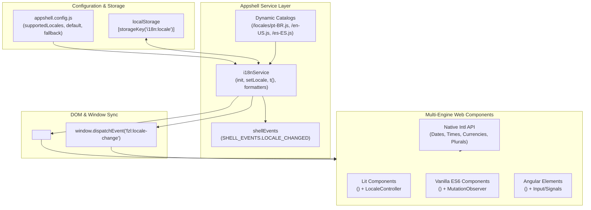

# Internationalization (i18n) & Localization (l10n) — Feature Roadmap

- **Status:** Planning & Ready for Execution
- **Target Version:** `0.2.0`
- **Related ADR:** [ADR-004: Internationalization (i18n) & Localization (l10n) Architecture](../architecture/004-internationalization-and-localization.md)

---

## 1. Executive Summary

This roadmap outlines the plan to implement full **internationalization (i18n)**, **localization (l10n)**, and **bidirectional layout support (RTL/LTR)** across the `fzl-fund-ui` monorepo.

The implementation is divided into **6 sequential phases** covering:
1. Design tokens & CSS logical properties audit
2. Core i18n service & storage in `appshell-lit`
3. Web Components localization contract across all engines (Lit, ES6, Angular)
4. Appshell UI translation catalogs & language settings view
5. Multi-engine playground showcase & live docs synchronization
6. Quality assurance, test coverage & translation validation tooling

---

## 2. High-Level Architecture Diagram

---

## 3. Work Breakdown Structure (WBS) & Task Checklist

### Phase 1: Foundations & Design Tokens (RTL Readiness)
> **Goal:** Ensure all styling in `@fzl/design-tokens` supports bidirectional layout (LTR/RTL) without hardcoded physical coordinates.

- [x] **Task 1.1 — CSS Logical Properties Audit:**
  - Audit `packages/design-tokens/src/tokens.ts` and ensure properties prefer logical rules (e.g. `inset-inline-start`, `margin-inline-start`, `padding-inline-end`).
  - Add direction helper tokens if necessary (e.g., `--fzl-direction: ltr`).
- [x] **Task 1.2 — Define Supported Locales & BCP 47 Constants:**
  - Establish initial supported languages:
    - `pt-BR` (Português - Brasil) — Primary default
    - `en-US` (English - United States)
    - `es-ES` (Español)
  - Create a shared constant list of supported locales with metadata (`code`, `label`, `dir`).
- [x] **Task 1.3 — Unit Tests for Token Integrity:**
  - Run `npm run check --workspace=@fzl/design-tokens` to guarantee zero regressions.

---

### Phase 2: Appshell i18n Engine & Services (`appshell-lit`)
> **Goal:** Build the reactive locale state manager, persistence layer, dynamic catalog loader, and formatting helpers.

- [x] **Task 2.1 — Storage Key Registration:**
  - Add `'i18n:locale'` to `src/storage-keys.js` with application prefix isolation (`prefixKey(__APP_STORAGE_PREFIX__, 'i18n:locale')`).
- [x] **Task 2.2 — App Configuration Schema (`src/app-config.js`):**
  - Add `i18n` section to `appshell.config.js` validation:
    - `defaultLocale` (default: `'pt-BR'`)
    - `fallbackLocale` (default: `'pt-BR'`)
    - `supportedLocales` (array of locale descriptors)
    - `autoDetect` (boolean, matches `navigator.languages`)
- [x] **Task 2.3 — Implement `i18nService` (`src/services/i18n-service.js`):**
  - Reactive state with `getLocale()`, `setLocale(code)`, `getSupportedLocales()`.
  - Browser detection fallback algorithm (`navigator.languages` -> `defaultLocale` -> `fallbackLocale`).
  - Automatic synchronization with `document.documentElement.lang` and `document.documentElement.dir`.
  - Dynamic asynchronous catalog loading (`loadCatalog(locale)`).
- [x] **Task 2.4 — Shell Events Integration (`src/services/shell-events.js`):**
  - Add `SHELL_EVENTS.LOCALE_CHANGED = 'shell:locale-changed'`.
  - Implement `bridgeLocale()` to broadcast changes.
  - Dispatch global window event `fzl:locale-change` for third-party custom elements.
- [x] **Task 2.5 — Translation & Formatting Utility (`t(key, params)`):**
  - Dot-notation dictionary traversal (`t('auth.loginButton')`).
  - Parameter interpolation (`t('welcome', { user: 'Alice' })`).
  - Pluralization support using native `Intl.PluralRules`.
  - Formatters: `formatDate(date, options)`, `formatNumber(value, options)`, `formatCurrency(amount, currency)`.
- [x] **Task 2.6 — Unit Tests for `i18nService`:**
  - Full test coverage in `src/services/i18n-service.test.js` (locale switching, storage persistence, fallback handling, formatting).

---

### Phase 3: Web Components Localization Contract
> **Goal:** Equip all web components with transparent, framework-agnostic localization support.

- [ ] **Task 3.1 — Shared Locale Utility (`@fzl/design-tokens` or component utility):**
  - Resolve active element locale: `element.getAttribute('lang') || element.closest('[lang]')?.lang || document.documentElement.lang || 'pt-BR'`.
  - Resolve active text direction (`dir` attribute or computed direction).
- [ ] **Task 3.2 — Lit Components (`webcomponents-lit`):**
  - Implement `LocaleController` (Lit Reactive Controller) that auto-re-renders on `fzl:locale-change` or `[lang]` mutation.
  - Refactor `<fzl-crumb>`:
    - Localize default `aria-label` ("Navegação estrutural" / "Breadcrumb navigation" / "Navegación de migas").
    - Localize default collapse indicator or labels.
  - Refactor `<fzl-clock>`:
    - Use `Intl.DateTimeFormat(locale, ...)` for localized date and time formats.
- [ ] **Task 3.3 — Vanilla ES6 Components (`webcomponents-es6`):**
  - Add `lang` to `observedAttributes`.
  - Implement attribute change listener + `window.addEventListener('fzl:locale-change')`.
  - Update `<fzl-es6-crumb>` and `<fzl-es6-button>`.
- [ ] **Task 3.4 — Angular Elements (`webcomponents-angular`):**
  - Add `@Input() lang?: string` property.
  - Bind to Angular locale / signals or native `Intl`.
  - Update `<fzl-ng-crumb>` and `<fzl-ng-button>`.
- [ ] **Task 3.5 — Component Documentation & Tests:**
  - Write unit tests verifying that changing `lang` updates `aria-label` and formatting across all engines.

---

### Phase 4: Appshell UI Translation & Settings View
> **Goal:** Translate all native appshell views and provide a user-facing language selector.

- [ ] **Task 4.1 — Create Base Locale Catalogs (`appshell-lit/src/locales/`):**
  - `pt-BR.js` (complete baseline)
  - `en-US.js` (complete translation)
  - `es-ES.js` (complete translation)
- [ ] **Task 4.2 — Translate Appshell Chrome & Core Views:**
  - Header & Footer (`app-header.js`, `app-footer.js`, `app-version.js`).
  - Navigation Drawer (`app-shell.js` menu labels).
  - Auth View (`auth-view.js` — login form, errors, session expiry).
  - Notifications View (`user-notifications.js`, `config-notifications-view.js`).
  - Accessibility View (`config-accessibility-view.js`).
  - Privacy & Consent Banner (`consent-banner.js`, `config-privacy-view.js`).
  - Connection & Offline Toast (`connection-status.js`).
- [ ] **Task 4.3 — Language Preferences View (`config-language-view.js`):**
  - Create a dedicated configuration view for selecting preferred language.
  - List supported languages with native names ("Português", "English", "Español").
  - Instant live switch with instant UI update without requiring full page reload.
  - Link into the Settings Drawer alongside Accessibility, Privacy, and Notifications.

---

### Phase 5: Demo Playground & Docs-as-Code
> **Goal:** Expose language controls in the local demo playground and update documentation.

- [ ] **Task 5.1 — Playground Language Selector in Appshell Demo:**
  - Add a language dropdown in `appshell-lit/demo/` header.
  - Demonstrate live switching of all multi-engine components simultaneously (Lit, ES6, Angular).
- [ ] **Task 5.2 — Update Component Specifications in `docs/components/`:**
  - Document the `lang` and `dir` attributes for `<fzl-crumb>`, `<fzl-clock>`, and other widgets.
  - Document default internal labels and slot override mechanisms.
- [ ] **Task 5.3 — Sync Custom Elements Manifest:**
  - Run `npm run docs:sync` to reflect new attributes in markdown tables.

---

### Phase 6: Validation, Tooling & CI
> **Goal:** Automated checks to prevent missing translation keys and broken builds.

- [ ] **Task 6.1 — Translation Parity Linter (`scripts/check-i18n.mjs`):**
  - Node.js script comparing keys in `pt-BR.js`, `en-US.js`, and `es-ES.js`.
  - Warns or fails CI if keys are missing in secondary languages.
- [ ] **Task 6.2 — Full CI Test Run:**
  - Add i18n test execution to monorepo test workflow (`npm test`).

---

## 4. Milestone Schedule & Suggested Execution Order

| Milestone | Target Scope | Output Artifacts | Estimated Effort |
| :--- | :--- | :--- | :--- |
| **M1: Core Engine** | Phase 1 & Phase 2 | `i18n-service.js`, unit tests, `app-config.js` | 2 days |
| **M2: Component Contract** | Phase 3 | `LocaleController`, multi-engine `<fzl-crumb>` & `<fzl-clock>` | 2 days |
| **M3: Appshell Catalogs & UI** | Phase 4 | Translation catalogs (`pt-BR`, `en-US`, `es-ES`), `config-language-view.js` | 3 days |
| **M4: Demo, Tooling & Docs** | Phase 5 & Phase 6 | Language picker in demo, docs sync, `check-i18n.mjs` | 1 day |

---

## 5. Acceptance Criteria

1. **Standalone Components:** Consuming `<fzl-lit-crumb lang="en-US">` in an external application (without `appshell-lit`) displays English accessibility labels and hierarchy.
2. **Dynamic Switching:** Switching the language in `config-language-view` instantly re-renders all appshell views and child web components without a full page refresh.
3. **Persistence:** Refreshing the browser or reopening the PWA retains the chosen language from `localStorage` under `storageKey('i18n:locale')`.
4. **Origin Isolation:** Changing the language in one app hosted under `wagnermarques.github.io/app-a/` does not alter the language of `wagnermarques.github.io/app-b/`.
5. **Zero Test Regressions:** All existing 229+ unit tests pass, plus 100% coverage on new i18n services.
